# pfsense-threat-detection-incident-response
Hands-on pfSense firewall security lab covering network segmentation, traffic analysis, TCP troubleshooting, and incident investigation.
# pfSense Security Lab — Part 4: Firewall Troubleshooting & TCP Traffic Analysis

## Project Overview

This hands-on cybersecurity homelab focuses on configuring pfSense network interfaces, testing firewall access controls, troubleshooting connectivity, and analyzing TCP traffic using Wireshark.

The lab demonstrates how firewall rules, network routing, and application behavior affect connectivity between isolated virtual networks.

**Skills Practiced:** pfSense Firewall Administration, Network Segmentation, TCP/IP, ICMP, Wireshark, Linux CLI, Network Troubleshooting, Firewall Log Analysis.

## 1. Lab Environment

| Component | Configuration |
|---|---|
| Hypervisor | Oracle VirtualBox |
| Firewall | pfSense 2.9.0 |
| Attacker/Test Machine | Kali Linux |
| Web Server | Ubuntu Server with Nginx |
| pfSense WAN | 10.0.2.15/24 — em0 |
| pfSense LAN | 192.168.50.1/24 — em1 |
| pfSense OPT1 | 192.168.60.1/24 — em2 |
| Ubuntu Server | 192.168.50.100 |
| Kali Test Interface | 192.168.60.100 |

### Network Topology

```text
                VirtualBox NAT
                      |
                pfSense WAN
                10.0.2.15
                      |
                   pfSense
                  Firewall
                 /        \
                /          \
        LAN (em1)          OPT1 (em2)
      192.168.50.1        192.168.60.1
            |                  |
       Ubuntu Server       Kali Linux
      192.168.50.100      192.168.60.100
        Nginx HTTP          Test Client
```

All testing was performed within an isolated VirtualBox homelab.

## 2. pfSense Interface Configuration

### Step 1 — Review Existing VirtualBox Network Adapters

Verified the existing pfSense virtual network configuration before adding the third interface.

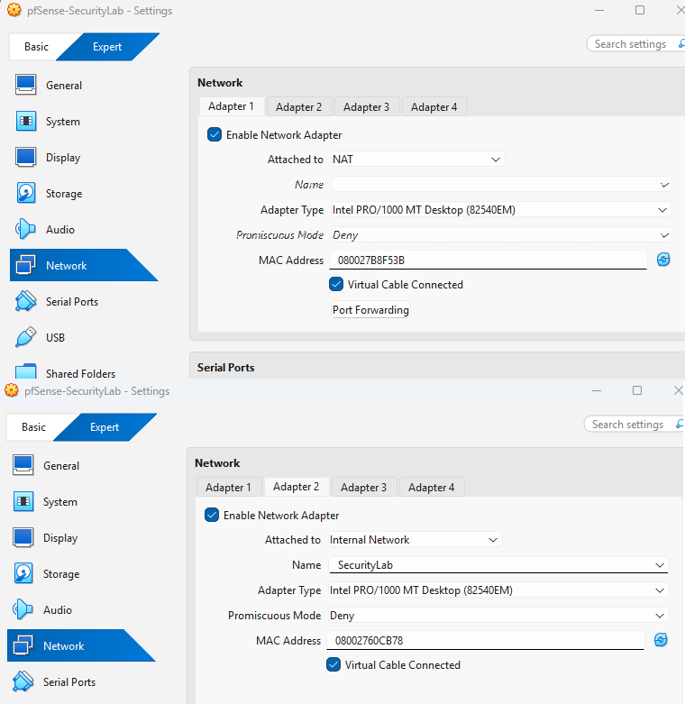

### Step 2 — Configure the TestNet Adapter

Added a third VirtualBox network adapter using the Internal Network named `TestNet`.

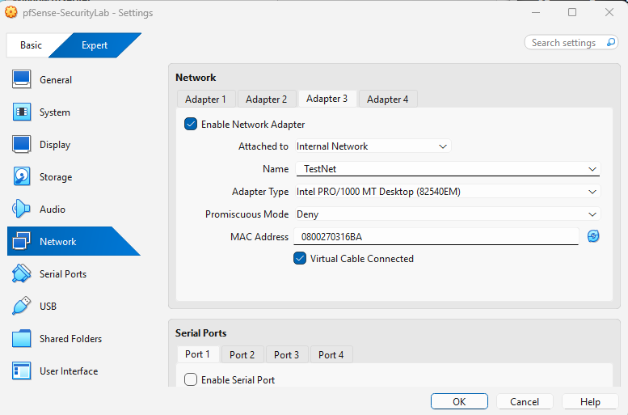

### Step 3 — Verify pfSense Interfaces

Checked the pfSense console to confirm available network interfaces.

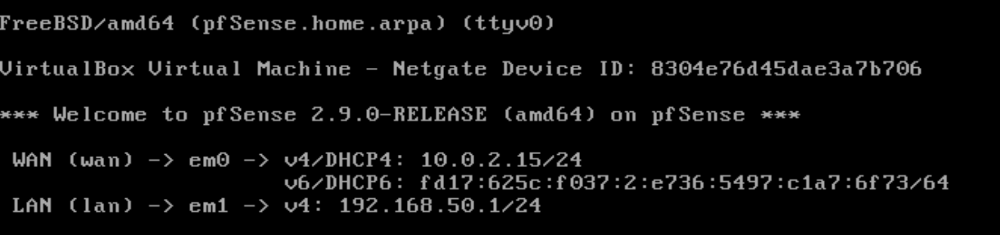

### Step 4 — Confirm em2 Detection

Verified that pfSense detected the additional network interface `em2`.

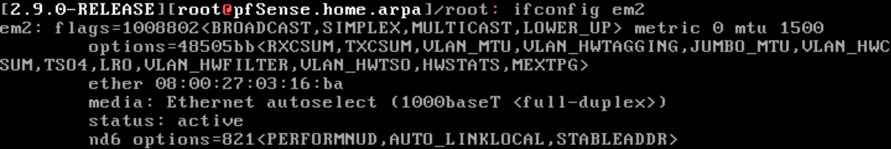

### Step 5 — Assign Interfaces

Configured the interface assignments for WAN, LAN, and OPT1.

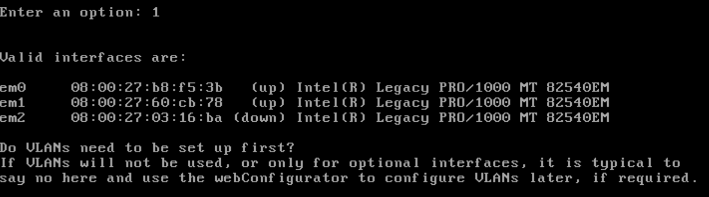

### Step 6 — Restore LAN and Assign OPT1

Confirmed the original LAN configuration and assigned the new interface to OPT1.

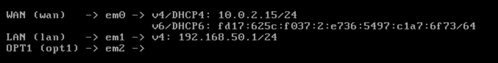

### Step 7 — Verify Three Interfaces

Confirmed that all three pfSense interfaces were configured.

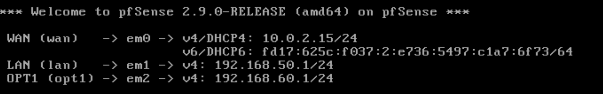

## 3. ICMP Firewall Investigation

### Step 8 — Investigate ICMP Traffic

Tested ICMP connectivity between Kali Linux and the Ubuntu server across the pfSense firewall.

The initial investigation demonstrated that traffic could be blocked by the firewall policy.

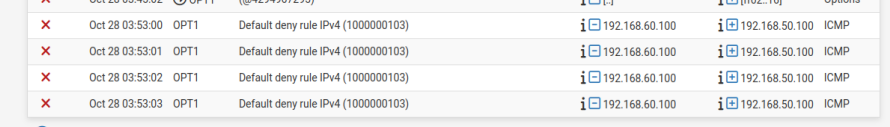

### Step 9 — Troubleshoot the ICMP Firewall Rule

An ICMP Pass rule was configured incorrectly for **Echo Reply** rather than **Echo Request**.

The rule was corrected to permit ICMP Echo Requests from Kali to Ubuntu.

After correcting the rule, ping testing succeeded.

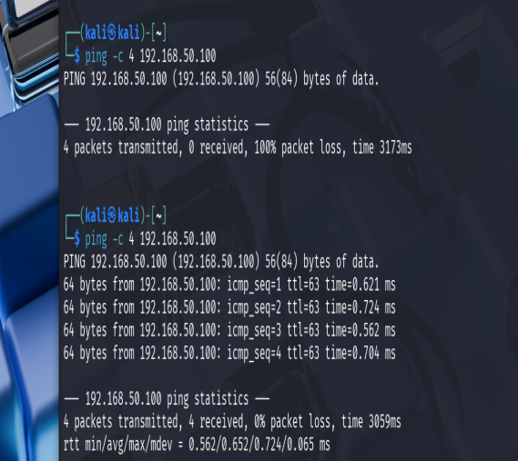

### Step 10 — Verify Firewall Logs

Reviewed pfSense firewall logs to confirm the change from blocked traffic to permitted ICMP traffic.

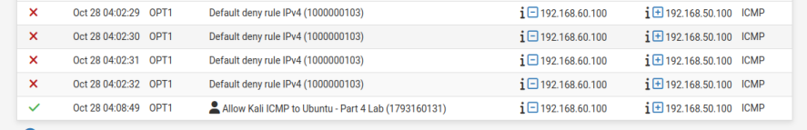

**Finding:** Selecting the correct ICMP message type is essential when creating firewall rules.

## 4. HTTP Firewall Testing

### Step 11 — Test Blocked HTTP Traffic

Tested TCP port 80 connectivity from Kali to the Ubuntu Nginx server.

Before creating an HTTP Pass rule, pfSense blocked the connection.

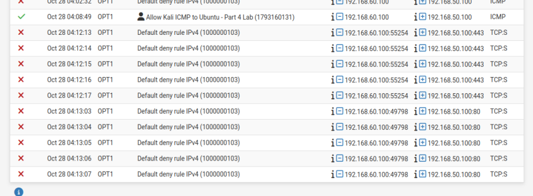

### Step 12 — Create and Test HTTP Pass Rule

Created a rule permitting TCP port 80 traffic from Kali to Ubuntu.

Test command:

```bash
curl -I --connect-timeout 5 http://192.168.50.100
```

The server returned:

```text
HTTP/1.1 200 OK
Server: nginx/1.24.0
```

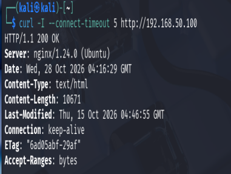

### Step 13 — Verify HTTP Traffic in Firewall Logs

Confirmed that pfSense recorded the permitted HTTP connection.

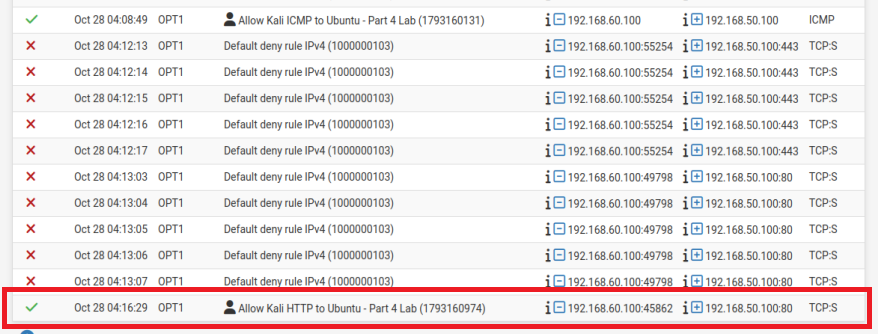

**Finding:** Successful HTTP communication requires both a permitted network path and an available web service.

## 5. TCP Port 8080 Investigation

### Step 14 — Investigate Blocked TCP 8080 Traffic

Attempted to connect to Ubuntu on TCP port 8080.

```bash
curl -v --connect-timeout 5 http://192.168.50.100:8080
```

The connection timed out while the firewall was blocking the traffic.

pfSense logs showed the blocked connection attempt.

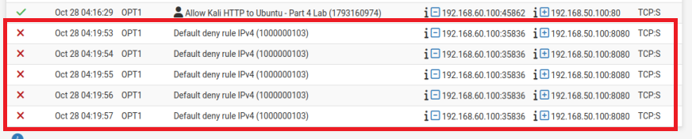

### Step 15 — Analyze TCP SYN Retransmissions

Captured the connection attempt using Wireshark on Kali's `eth1` interface.

Display filter:

```text
ip.addr == 192.168.50.100 && tcp.port == 8080
```

Wireshark showed repeated TCP SYN packets without a successful response.

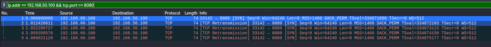

Packet capture:

[captures/tcp8080-blocked-retransmission.pcapng](captures/tcp8080-blocked-retransmission.pcapng)

**Finding:** SYN retransmissions indicate that a connection attempt has not received the expected response. Firewall filtering is one possible cause.

### Step 16 — Temporarily Allow TCP 8080

Created a temporary pfSense Pass rule for TCP port 8080.

During testing, the connection initially continued to time out despite the rule being enabled.

Further investigation revealed that Kali had lost its static route after a reboot.

The connection was being routed through the VirtualBox NAT gateway instead of the pfSense OPT1 interface.

### Routing Troubleshooting

Checked the destination route:

```bash
ip route get 192.168.50.100
```

Restored the route through pfSense:

```bash
sudo ip route replace 192.168.50.0/24 via 192.168.60.1 dev eth1
```

After correcting the route, traffic reached the intended firewall path.

**Root Cause:** The manually configured Kali route was not persistent across reboots.

### Step 17 — Observe TCP Connection Refused

Repeated the TCP port 8080 test while the temporary firewall Pass rule was enabled.

```bash
curl -v --connect-timeout 5 http://192.168.50.100:8080
```

The connection was refused because no application was listening on TCP port 8080.

Wireshark confirmed:

```text
Kali Linux                    Ubuntu Server
    |                               |
    | -------- TCP SYN -----------> |
    |                               |
    | <------- TCP RST, ACK ------- |
    |                               |
```

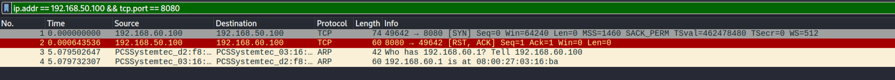

Packet capture:

[captures/tcp8080-connection-refused.pcapng](captures/tcp8080-connection-refused.pcapng)

**Finding:** A TCP RST response indicates that the connection was actively rejected, unlike a filtered connection where packets may receive no response.

### Step 18 — Remove Temporary Firewall Rule

Deleted the temporary TCP port 8080 Pass rule and applied the firewall changes.

Repeated the connection test.

**Result:** TCP port 8080 timed out again, consistent with the restored default-deny firewall policy.

This verified that temporary testing access had been removed.

## 6. Troubleshooting Results

| Test | Observation | Interpretation |
|---|---|---|
| ICMP before correction | Ping failed | Incorrect firewall rule configuration |
| ICMP after correction | Ping succeeded | Echo Request permitted |
| HTTP port 80 blocked | Connection unsuccessful | Firewall denied traffic |
| HTTP port 80 allowed | HTTP 200 OK | Firewall and Nginx working |
| TCP 8080 blocked | Timeout and SYN retransmissions | Traffic filtered |
| TCP 8080 allowed | SYN followed by RST, ACK | No service listening |
| Kali after reboot | Incorrect route | Static route was lost |
| TCP 8080 rule removed | Timeout restored | Default-deny policy restored |

## 7. Key Lessons Learned

1. Firewall rules must match the correct source, destination, protocol, and port.
2. ICMP Echo Request and Echo Reply are different message types.
3. TCP SYN retransmissions and TCP RST responses provide different troubleshooting clues.
4. A firewall Pass rule does not guarantee that an application is listening on the destination port.
5. Routing must be verified before assuming a firewall rule is malfunctioning.
6. Temporary static routes may disappear after a reboot.
7. Firewall logs and Wireshark captures are useful together when investigating network connectivity.
8. Temporary testing rules should be removed after validation.

## 8. Tools and Commands Used

| Tool / Command | Purpose |
|---|---|
| pfSense Firewall Rules | Configure and enforce traffic policy |
| pfSense Firewall Logs | Inspect blocked and permitted connections |
| `ping` | Test ICMP connectivity |
| `curl -I` | Test HTTP response headers |
| `curl -v` | Investigate connection behavior |
| `ip route get` | Check the selected route |
| `ip route replace` | Correct the destination route |
| Wireshark | Inspect TCP flags and packet behavior |
| `pfctl -sr` | Review loaded pfSense
